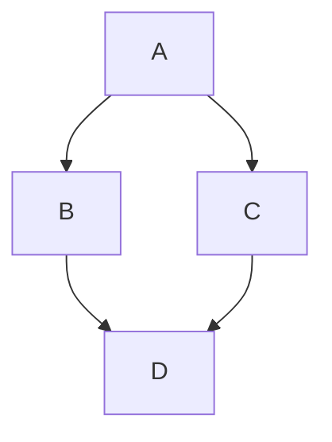

# Organización y Arquitectura de computadoras [O2026_ESI3913N2]
## Práctica I - Torres de Hanoi (2026-10-26)

### Introducción (Copiada de la rúbrica)

> El problema de las Torres de Hanói consiste en desplazar una columna hecha a base de discos concéntricos de diferentes diámetros, apilados del de mayor diámetro al de menor diámetro,
> desde su posición original A hasta su posición destino C, teniendo el punto B disponible para movimientos intermedios.
> Dicho desplazamiento cuenta con la restricción de que solo se puede mover un disco a la vez, y que en ningún momento puede un disco de mayor diámetro estar sobre un disco de menor diámetro.

### Diagrama de flujo del programa

